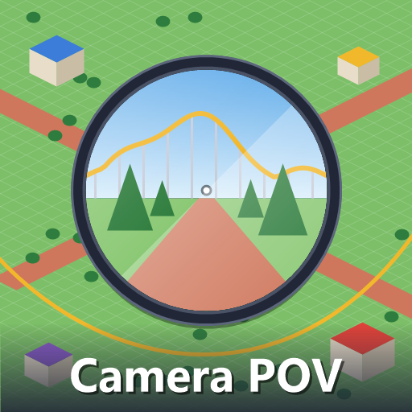

# Camera POV

A [Parkitect](https://www.themeparkitect.com/) mod to see your park from the inside: walk around it at a guest's eye level, fly over it, see it through a guest's eyes, or ride your own coasters.

[Steam Workshop page](https://steamcommunity.com/sharedfiles/filedetails/?id=3835039248)



## How to use it

- Press **G**. The camera goes down to the spot in the middle of the screen, at a guest's eye level. Press **G** or **Esc** to go back to the normal camera, which comes back above where you are, with the same zoom and angle it had. It works with the game's camera and with the Perspective Camera mod.
- Hold **Alt** to free the cursor and click windows. A small dot marks the middle of the screen, which is where hovering and clicking land.
- With the window of a guest, an employee or a ride open, **G** goes into it instead. Its window closes so it doesn't cover the view, and opens again when you go back to the normal camera.

### Walking

- The mouse looks around, the camera keys (**WASD**) walk and **Shift** runs. The mouse wheel changes the walking speed. **Space** jumps.
- You walk on the terrain, paths, stairs, raised paths, built floors, bridges and roofs, and fall off when the ground ends.
- Buildings, scenery, rides, tracks and fences stop you, and you slide along walls. **Tab** switches collision off and on.

### Flying

- **F** switches between walking and flying. Flying goes through everything.
- **E** or **Space** goes up, **Q** or **Left Ctrl** goes down, and the mouse wheel changes the speed.

### Through someone's eyes

- Open the window of a guest or an employee and press **G**. The camera follows them wherever they go, rides included.
- The mouse turns your head, and the view turns back to where they are heading after a couple of seconds.
- Their body is hidden but keeps its shadow, and what they hold stays in view.
- The camera keys walk on from there on your own, and **F** flies off.

### On a ride

- Open the window of a coaster, a boat ride or a flat ride and press **G**. You sit in the first seat of the first car.
- The mouse wheel changes seat within the car. **Tab** goes to the next car, and to the next train after the last one. **Shift + Tab** goes back.
- Anyone sitting in your seat is hidden. **F** flies off the ride.

### Sound

The game places sounds by where they are on screen, which suits the view from above. While Camera POV is on, sounds are placed by their real distance and side instead.

### Settings

Eye height, field of view, mouse sensitivity, inverted vertical look, collision while walking and the transition time are in the mod's settings. All keys can be changed in the game's controls settings, under Camera POV.

The mod's texts are in English and Brazilian Portuguese, following the game's language. The camera is only yours, so other players in a multiplayer game don't need the mod.

## Building

You need the .NET SDK and Parkitect installed.

```bash
dotnet build -c Release
```

The build copies the mod, Harmony and the preview into `Documents/Parkitect/Mods/camera_pov`. If the game or the mods folder is somewhere else:

```bash
dotnet build -c Release -p:ParkitectManaged="<Parkitect>/Parkitect_Data/Managed" -p:ModOutputDir="<mods folder>/camera_pov"
```

## Code

| File | What it does |
| --- | --- |
| `src/camera_pov_mod.cs` | Entry point: keys, settings UI, Harmony |
| `src/camera_rig.cs` | Takes the camera and runs walking, flying, possessing, riding and the transitions |
| `src/walk_collision.cs` | Collision while walking, using the game's mouse collision shapes |
| `src/ride_seats.cs` | Seats of tracked rides, boat rides and flat rides |
| `src/selected_object.cs` | The person or ride whose window is in front |
| `src/flat_panning_patch.cs` | Places sounds by real distance while a mode is on |
| `src/highlight_patch.cs` | Hides the outline of the possessed person |
| `src/camera_pov_settings.cs` | Settings, saved as JSON next to the game's settings |
| `src/texts.cs` | English and Brazilian Portuguese texts |

## Credits

Inspired by LordAsdi's [FlyCam](https://github.com/LordAsdi/Parkitect_FlyCam) and H-POPS' CoasterCam, written from scratch. Patches are made with [Harmony](https://github.com/pardeike/Harmony) (MIT), which is bundled with the mod.

## License

[MIT](LICENSE)
